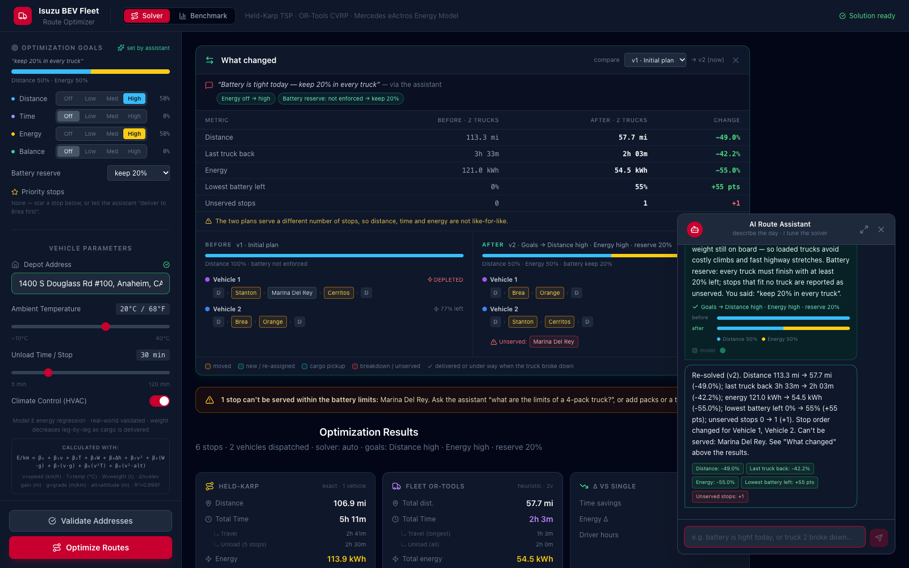
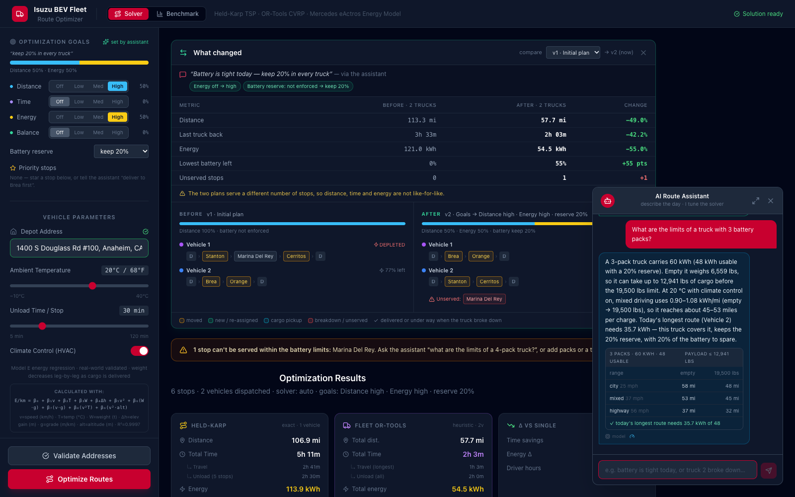
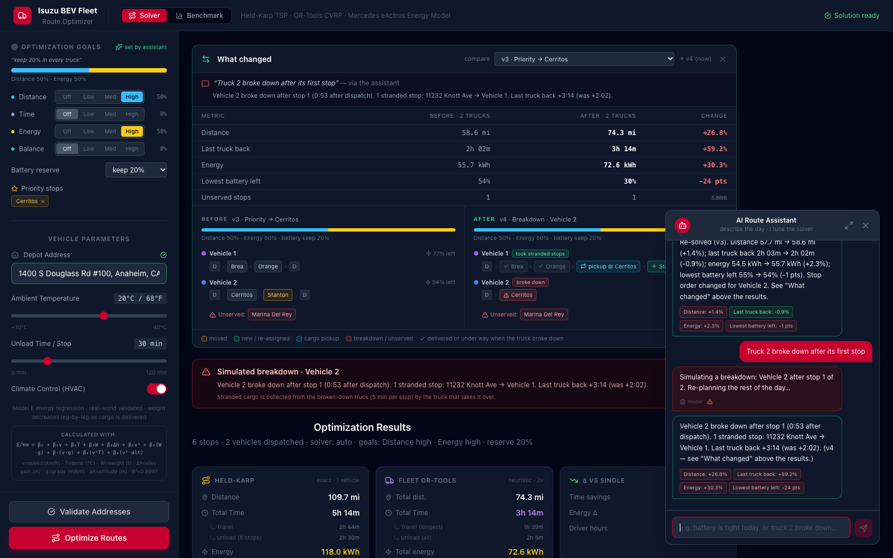
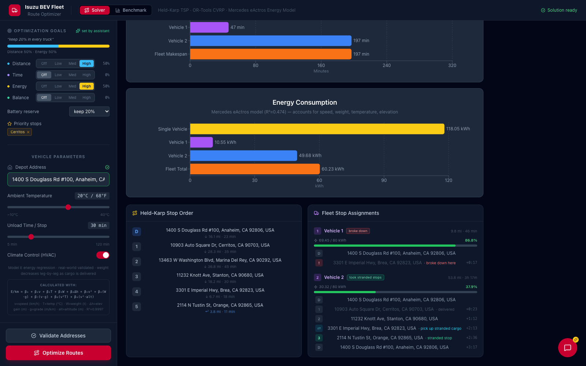

# Optimization goals, truck limits and breakdowns

**Code:** the "Optimization goals, truck limits and breakdown re-planning" section of
[`route_optimizer_backend.py`](../route_optimizer_backend.py#L637) and
[`solve_vrp_constrained()`](../solvers.py#L345) in `solvers.py`.
UI: [`GoalsPanel.jsx`](../route-optimizer-frontend/src/GoalsPanel.jsx),
[`PlanComparison.jsx`](../route-optimizer-frontend/src/PlanComparison.jsx),
[`planDiff.js`](../route-optimizer-frontend/src/planDiff.js).

An operator should not have to know what a weight is. They say what the day looks like
("battery is tight", "we're running late", "truck 2 broke down"). The chat assistant
turns that into settings, the plan is re-solved, and the UI shows the plan before and
after side by side. This page explains what those settings do to the solver.

**"Battery is tight today — keep 20% in every truck"**: the assistant raises the Energy goal
and sets a 20% reserve, the plan is re-solved, and **What changed** shows before | after.



**"What are the limits of a truck with 3 battery packs?"**: battery, payload and range,
checked against today's longest route.



**"Truck 2 broke down after its first stop"**: Vehicle 1 finishes its own stops, then picks
up the stranded cargo at the breakdown site and delivers it.



**"Truck 1 broke down after its first stop, send a spare truck"**: here Vehicle 2 can cover
the stranded stop more cheaply than a spare from the depot. The stop list marks delivered
stops, the cargo pickup, the stranded stop and the breakdown, with arrival times.



## Optimization goals

There are four goals. Each is set to **off, low, medium or high**, which count as 0, 1,
2 and 4, and the counts are scaled so the weights add up to 100%:

| Goal | What a leg costs under it | Default |
|---|---|---|
| Distance | its driving distance | high |
| Time | Google's typical driving time | off |
| Energy | its Model E energy at the truck's mid-load weight, so speed, climbs and load count | off |
| Balance | nothing per leg; the **latest truck's finish time** is priced instead (2+ trucks) | off |

Each leg's cost is a weighted mix, with every term divided by the average leg so that
miles, minutes and kWh can be added together
([`objective_matrix()`](../route_optimizer_backend.py#L759)):

```
cost(i→j) = 100,000 × ( w_distance · d(i,j) / avg d
                      + w_time     · t(i,j) / avg t
                      + w_energy   · e(i,j) / avg e )        e is floored at 0: downhill legs earn no credit
balance   = OR-Tools global span cost on the finish times,   priced so "high" competes with the routing cost
```

- **The defaults reproduce the old behaviour.** "Distance high", with everything else off,
  hands the solvers the plain distance matrix, as before.
- **With one truck**, balance counts as time, because finishing that one route sooner is
  the same thing. If only balance is on, driving time breaks ties.
- **The single-truck solvers** (Held-Karp, 2-opt, nearest neighbor) minimise the same
  matrix. So do the routes' `cost` fields, which are now in objective units rather than
  metres.
- **Energy is still reported exactly**, leg by leg, with the weight dropping at each
  stop. The goal only decides which route wins.

The assistant picks the levels; the operator never types a number. "Battery is tight
today" → Energy high, Distance low. The table above turns levels into numbers, and the
reply explains what each raised goal does. In the sidebar the operator can also set the
levels by hand.

## Battery reserve

`battery_reserve_pct` is the share of every truck's battery that must be left when it gets
back. It can be **not enforced** (the default: battery is reported only), or 0–50%, where
0% means "never run a truck flat".

- **Fleet (2+ trucks): enforced.** Each truck gets an energy limit of
  `packs × 20 kWh × (1 − reserve)`. The route energy for the limit is priced at the truck's
  *full* gross weight and never credits regen, so the limit errs on the safe side; the
  reported energy is the exact, unloading one. The per-truck stop cap becomes soft, so a
  big-battery truck can take extra stops. A stop that fits no truck is left out and listed
  in `unserved` rather than silently dropped.
- **One truck: checked, not enforced.** It has to visit every stop. The result carries
  `battery_reserve_ok` and the UI flags a shortfall.

## Priority stops

A priority stop is served before the other stops on whichever truck gets it. Every arc
from a regular stop into a priority stop costs more than any whole route, so the solver
puts priority stops first. It does not mean "the truck that is fastest to get there" or a
time window: time windows are not modelled. Set it with the star next to a stop, or tell
the assistant "deliver to Brea first" / "Cerritos is urgent". The stop has to be one
already on the form.

## Breakdown re-planning

`POST /api/replan` ([`replan_breakdown()`](../route_optimizer_backend.py#L1116))
takes the current plan and a breakdown: which truck, and either *after its k-th stop* or
*m minutes after dispatch*. It re-plans the rest of the day:

```
all trucks leave the depot at t = 0
                                   breakdown
Vehicle 2  D ──► Stanton ✓ ────────── ✗   Cerritos (stranded, cargo still on Vehicle 2)
Vehicle 1  D ──► Brea ✓ ──► Orange ✓ ──► pickup @ Stanton ──► Cerritos ──► D
                            (under way: finishes this stop first)
```

1. **Replay the plan.** Every truck's arrival and departure times are computed, with the
   unload time at each stop.
2. **The broken truck** has delivered its first k stops and stops at the k-th. If the
   breakdown is given in minutes, it is placed at the last stop it completed. Its other
   stops are **stranded**, with their cargo on board.
3. **Every other truck** finishes the stop it is driving to or unloading at, then carries
   on from there with the battery and cargo it has left. Its own remaining stops stay on
   it, because that cargo is already loaded. A truck already done for the day is free once
   it is back at the depot.
4. **Stranded stops go to whichever truck can take them.** That truck first drives to
   the breakdown site and moves the cargo across: a pickup-and-delivery pair, same truck,
   pickup first, 5 minutes per stop. It must stay within its remaining battery (and the
   reserve, if one is set) and the 19,500 lbs gross weight limit.
5. **A spare truck** can be sent from the depot at the moment of the breakdown. With one
   truck in the plan, a spare is always sent. If the trucks already on the road can cover
   the stops more cheaply, the spare stays at the depot and the reply says so.
6. **Stops nobody can take** are listed as unserved, with the reason. Stops the plan had
   already left unserved stay unserved.

Every route in the result carries `status` (`broken_down`, `rescue`, `continues`,
`spare`), `stop_kinds` (`depot`, `done`, `stop`, `pickup`, `rescue`) and `eta_s` (arrival
after dispatch) per stop.

**Limits of the model.** The breakdown site is the last completed stop, not a point on the
road. Cargo is moved stop by stop, with no partial loads. Only one breakdown is simulated
at a time, on the latest plan that is not itself a breakdown. A later chat change re-plans
the day from the start and clears the simulated breakdown.

## Truck limits

[`truck_limits()`](../route_optimizer_backend.py#L1368) answers "what are the limits
of a truck with 3 battery packs?". Every number is computed:

| | 3 packs, 20 °C, HVAC on |
|---|---|
| Battery | 3 × 20 = 60 kWh (minus the reserve, if one is set) |
| Empty weight | 7,000 + (3 − 4) × 440.9 = 6,559 lbs |
| Payload | 19,500 − 6,559 = 12,941 lbs |
| Range | Model E on a flat road at 40 / 60 / 90 km/h, empty and fully loaded: about 56–66 mi in mixed driving |
| Today's routes | the longest route's energy from the last solve, against the usable battery, and the fewest packs that would cover it |

## How a chat change reaches the plan

```
operator: "Battery is tight today — keep 20% in every truck"
  └─ /api/chat → intent "goals" → change {axis: "goals", value: {energy: "high", battery_reserve_pct: 20, ...}}
       └─ the page applies it (the Optimization Goals panel flashes)
            └─ re-solve with the same matrices (no Google calls) → new plan version
                 ├─ "What changed": settings, metrics before / after / Δ, both plans' stop orders
                 └─ the chat posts the measured effect, e.g. on the Anaheim demo with two 4-pack trucks:
                    "Re-solved (v2). Distance 113.3 mi → 57.7 mi (-49.0%); … unserved stops 0 → 1 (+1).
                     Stop order changed for Vehicle 1, Vehicle 2. Can't be served: Marina Del Rey."
```

In that example the 20% reserve leaves Marina Del Rey (about 40 miles out) unserved: no
4-pack truck can get there and back and still keep 20% of its battery. In the original plan
Vehicle 1 needed more energy than its battery holds (about 103 of 80 kWh).

Every solve is kept as a version (up to 12), so any two can be compared from the
**What changed** panel. If one plan serves fewer stops than the other, the panel says the
totals are not like-for-like.
